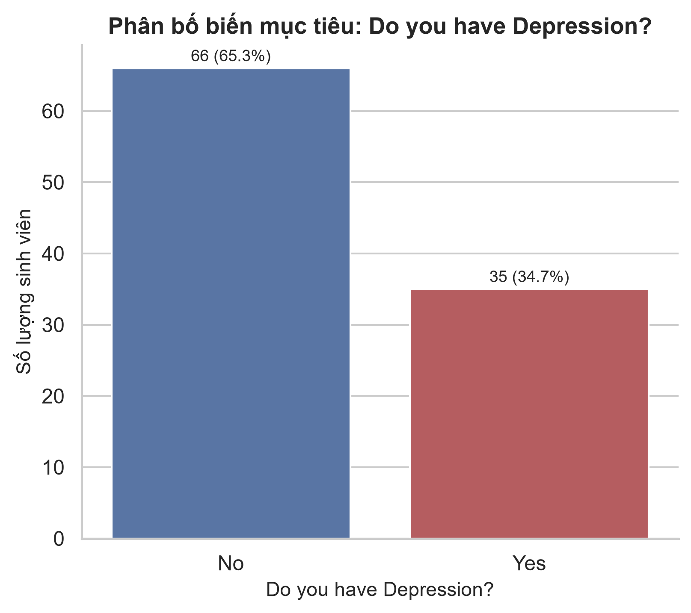
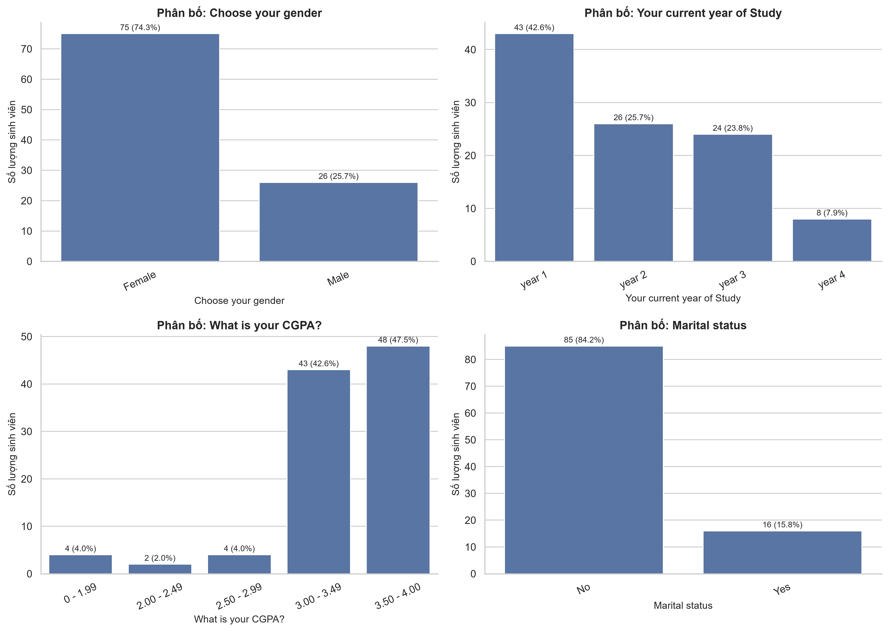
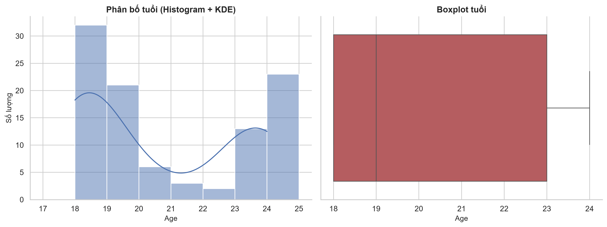
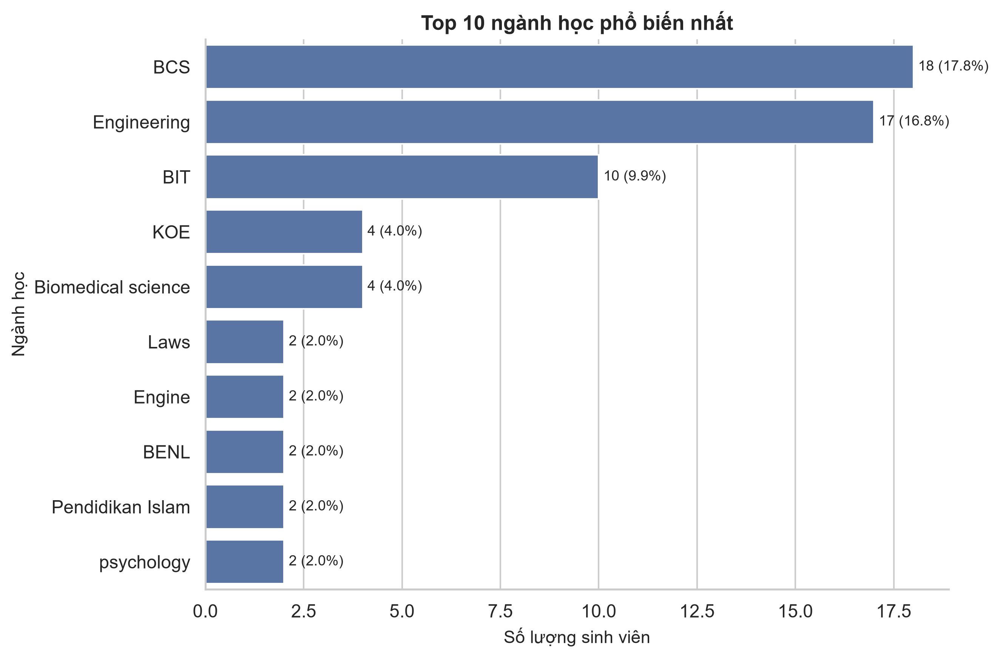
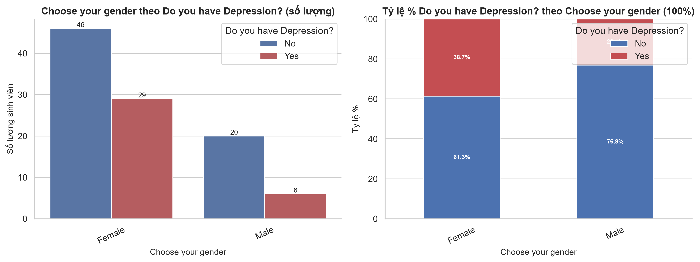
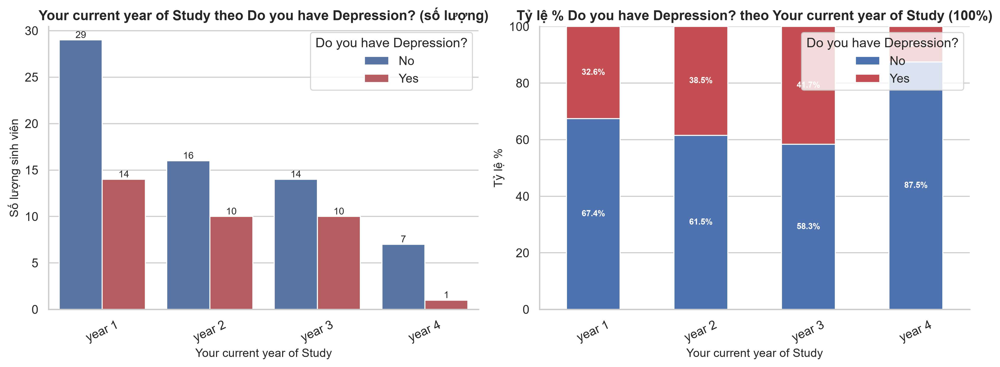
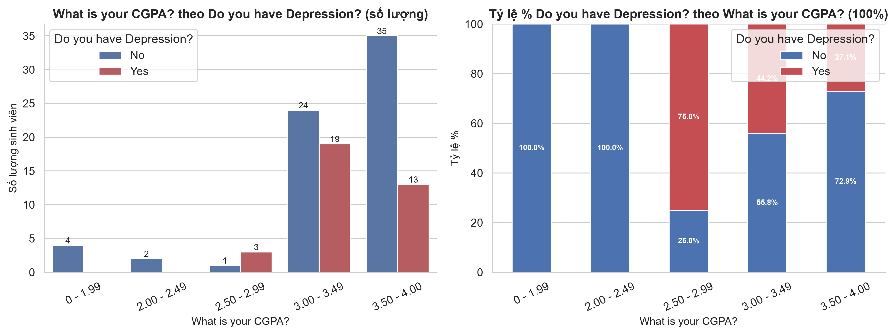
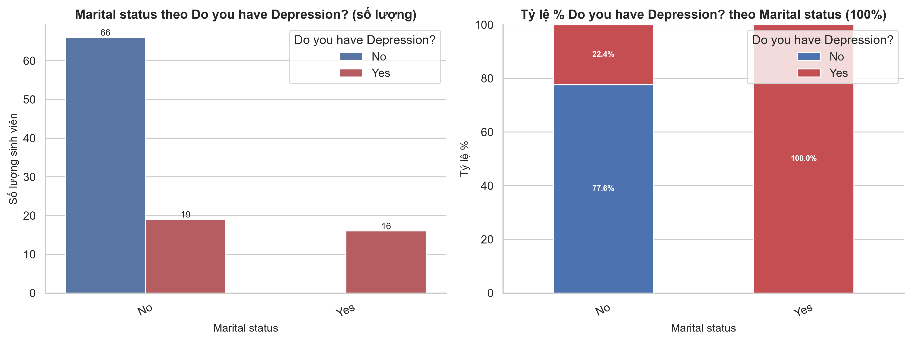
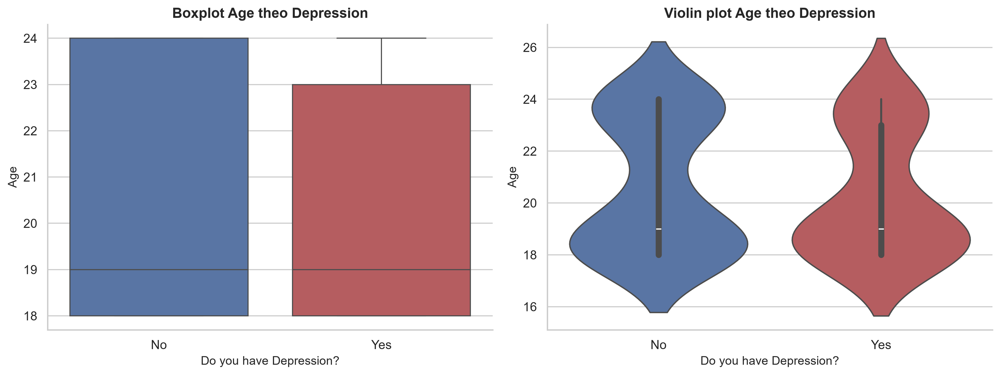
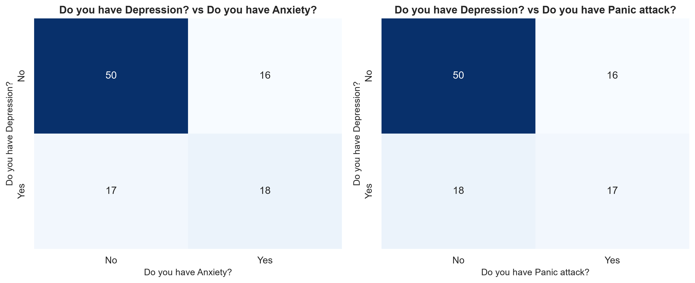

# Báo cáo Phân tích Khám phá Dữ liệu (EDA)

**Đề tài:** Student Depression Self-report Prediction Using Classical Machine Learning

**Bộ dữ liệu:** Kaggle — *Student Mental Health* (101 bản ghi × 11 cột)

**Người thực hiện:** Member 1 — Data Understanding & EDA

**Nguồn số liệu:** [`notebooks/02_eda.ipynb`](../notebooks/02_eda.ipynb) (thực thi trên [`data/raw/Student Mental health.csv`](<../data/raw/Student Mental health.csv>) qua hàm `clean_raw_data` trong [`src/preprocessing.py`](../src/preprocessing.py))

**Artifact:** biểu đồ trong [`results/figures/`](../results/figures), bảng số liệu trong [`results/tables/`](../results/tables)

---

## 0. Nguyên tắc diễn giải — bắt buộc đọc trước

Bộ dữ liệu này là **khảo sát cắt ngang (cross-sectional), tự khai báo (self-report), cỡ mẫu nhỏ (n = 101)**. Do đó:

1. **Tuyệt đối không diễn giải nhân quả.** Các câu như *"CGPA thấp gây ra trầm cảm"*, *"sinh viên năm 3 bị trầm cảm vì áp lực học tập"* là **sai về mặt phương pháp** và không được sử dụng trong báo cáo. Toàn bộ nội dung dưới đây chỉ mô tả **mối liên hệ thống kê quan sát được trong mẫu**.
2. Ngôn ngữ được dùng thống nhất: *"có liên hệ với"*, *"tỷ lệ cao hơn/thấp hơn trong mẫu"*, *"khác biệt quan sát được"*, *"gợi ý"*, *"chưa đủ căn cứ để kết luận"*. Không dùng *"gây ra"*, *"dẫn đến"*, *"ảnh hưởng"*, *"tác động"* theo nghĩa nhân quả.
3. Không có nhóm đối chứng, không có can thiệp, không có dữ liệu theo thời gian ⇒ **không thể xác lập quan hệ nhân quả** kể cả khi một liên hệ có ý nghĩa thống kê.
4. Mọi khác biệt về tỷ lệ đều phải đọc kèm **cỡ nhóm (n)**. Với n = 101, một nhóm chỉ có 2–4 quan sát thì 1 người thay đổi nhãn đã làm tỷ lệ nhảy 25–50 điểm phần trăm.

---

## 1. Tóm tắt quy trình làm sạch dữ liệu trước EDA

### 1.1 Nguyên tắc thiết kế

Quy trình chỉ chuẩn hóa **định dạng**, **không** thay đổi ngữ nghĩa, **không** điền giá trị thiếu, **không** gộp nhóm. File gốc `data/raw/Student Mental health.csv` được mở ở chế độ **chỉ đọc** và không bao giờ bị ghi đè (đã kiểm chứng bằng hash SHA-256 trước/sau khi chạy: không đổi).

### 1.2 Các bước đã thực hiện

| # | Thao tác | Phạm vi | Kết quả |
|---|---|---|---|
| 1 | `df.copy()` | Toàn bộ DataFrame | Làm việc trên bản sao, dữ liệu gốc trong bộ nhớ không bị thay đổi |
| 2 | `df.columns.str.strip()` | Tên 11 cột | Không phát hiện khoảng trắng thừa ở tên cột |
| 3 | `.str.strip()` | Giá trị các cột kiểu chuỗi | Xóa 7 giá trị thừa khoảng trắng cuối ở `What is your course?` và 1 ở `What is your CGPA?` |
| 4 | `.str.lower()` | `Your current year of Study` | 7 giá trị → **4** giá trị (`year 1`…`year 4`) |
| 5 | **Không** điền giá trị thiếu | `Age` | Giữ nguyên **1 NaN** |
| 6 | **Không** gộp tên ngành | `What is your course?` | 49 → **48** giá trị (chỉ do strip trùng khớp, không gộp thủ công) |

### 1.3 Hai quyết định quan trọng cần nêu rõ trong báo cáo

**(a) Giữ nguyên 1 giá trị thiếu ở `Age` — không điền tại bước này.**
Giá trị thiếu nằm ở dòng chỉ số 43 (`Timestamp = 8/7/2020 15:07`, giới tính Male, ngành BIT, `year 1`, CGPA `0 - 1.99`, không trầm cảm). Nếu điền median **trước khi** chia cross-validation, giá trị median được tính từ chính tập kiểm định ⇒ thông tin của tập test rò rỉ vào tập train (**data leakage**). Vì vậy `Age` được giữ nguyên NaN và việc điền sẽ do `SimpleImputer(strategy="median")` thực hiện **bên trong** `Pipeline`, fit riêng trên từng fold train của Member 3.

**(b) Không gộp tùy tiện các tên ngành ở `Course`.**
Các giá trị như `Engineering` (17), `Engine` (2), `engin` (1) hay `KOE`/`Koe`/`koe` (4 + 1 + 1) rất có thể là cùng một ngành, nhưng **chưa có căn cứ xác minh** (không có từ điển ngành của trường, không có tài liệu mô tả mã ngành). Việc tự gộp sẽ tạo ra một biến mới mang phán đoán chủ quan của người làm sạch, không thể tái lập và có thể che giấu khác biệt thật. Do đó **chỉ strip**, giữ nguyên 48 giá trị, và ghi nhận đây là hạn chế cần xử lý ở bước mô hình hóa (xem §2.4 và §5).

### 1.4 Trạng thái dữ liệu sau làm sạch

| Chỉ số | Giá trị |
|---|---|
| Kích thước | 101 × 11 |
| Dòng trùng lặp hoàn toàn | 0 |
| Ô thiếu | 1 (`Age`) |
| Số feature sau khi tách | 6 (`X` shape = 101 × 6) |
| Nhãn | `y`: 66 × `0` (No), 35 × `1` (Yes) |

---

## 2. Nhóm 1 — Phân tích phân bố đơn biến

### 2.1 Biến mục tiêu `Do you have Depression?`

| Nhãn | Số lượng | Tỷ lệ |
|---|---|---|
| No (0) | 66 | 65.35% |
| Yes (1) | 35 | 34.65% |

**① Quan sát nổi bật nhất.** Nhãn `No` chiếm 66/101 (65.35%), `Yes` chiếm 35/101 (34.65%), tương quan **1.89 : 1**. Đây là mất cân bằng nhẹ (mild imbalance) — không nghiêm trọng như bài toán gian lận tài chính, nhưng đủ để một mô hình "ngây thơ" đoán toàn bộ `No` đạt accuracy 65.35% mà không học được gì.

**② Nhóm chiếm tỷ lệ lớn nhất / nhỏ nhất.** Lớn nhất: `No` (65.35%). Nhỏ nhất: `Yes` (34.65%) — là **lớp thiểu số**, đồng thời là lớp mà đề tài quan tâm (positive class).

**③ Khác biệt về tỷ lệ Depression.** Không áp dụng (đây là chính biến mục tiêu).

**④ Hàm ý cho mô hình của Member 3.**
- Bắt buộc dùng **Stratified K-Fold** (khuyến nghị 5-fold, lặp 10 lần — `RepeatedStratifiedKFold`) để mỗi fold giữ tỷ lệ ≈ 65/35; với 5-fold mỗi fold chỉ có ~20 mẫu, trong đó ~7 mẫu `Yes`, nên chia ngẫu nhiên thường (non-stratified) có thể cho ra fold lệch nghiêm trọng.
- **Không dùng Accuracy làm chỉ số chính.** Ưu tiên **F1-score của lớp Yes**, **ROC-AUC**, và **PR-AUC / Average Precision** (nhạy với lớp thiểu số hơn).
- Cân nhắc `class_weight="balanced"` cho Logistic Regression / Random Forest / SVM; nếu dùng resampling (SMOTE) thì **chỉ áp dụng trên tập train trong từng fold**, không áp dụng lên toàn bộ dữ liệu trước khi chia fold.
- Báo cáo kèm confusion matrix và ngưỡng quyết định (threshold) thay vì chỉ mặc định 0.5.

**⑤ Giới hạn.** 35 mẫu dương tính là rất ít: khoảng tin cậy 95% của tỷ lệ 34.65% (Wilson) xấp xỉ **26%–44%**, tức sai số ±9 điểm phần trăm. Mọi so sánh giữa các mô hình có chênh lệch F1 dưới ~0.05 gần như không phân biệt được về mặt thống kê.

---

### 2.2 Giới tính, Năm học, Khoảng CGPA, Tình trạng hôn nhân

| Biến | Giá trị | Số lượng | Tỷ lệ |
|---|---|---|---|
| `Choose your gender` | Female | 75 | 74.26% |
| | Male | 26 | 25.74% |
| `Your current year of Study` | year 1 | 43 | 42.57% |
| | year 2 | 26 | 25.74% |
| | year 3 | 24 | 23.76% |
| | year 4 | 8 | 7.92% |
| `What is your CGPA?` | 3.50 – 4.00 | 48 | 47.52% |
| | 3.00 – 3.49 | 43 | 42.57% |
| | 2.50 – 2.99 | 4 | 3.96% |
| | 0 – 1.99 | 4 | 3.96% |
| | 2.00 – 2.49 | 2 | 1.98% |
| `Marital status` | No | 85 | 84.16% |
| | Yes | 16 | 15.84% |

**① Quan sát nổi bật nhất.** Mẫu bị lệch mạnh về **sinh viên nữ (74.26%)** và **sinh viên năm 1 (42.57%)**; đồng thời **91/101 (90.1%)** sinh viên có CGPA từ 3.00 trở lên. Ba đặc điểm này cho thấy mẫu khảo sát là một nhóm rất đồng nhất về mặt học lực — gần như không có sinh viên học lực yếu.

**② Nhóm lớn nhất / nhỏ nhất.**
- `gender`: lớn nhất Female 75 (74.26%), nhỏ nhất Male 26 (25.74%).
- `year of Study`: lớn nhất **year 1 = 43 (42.57%)**, nhỏ nhất **year 4 = 8 (7.92%)** — chênh 5.4 lần.
- `CGPA`: lớn nhất **3.50 – 4.00 = 48 (47.52%)**, nhỏ nhất **2.00 – 2.49 = 2 (1.98%)**. Nhóm CGPA < 3.00 chỉ có 10 người (9.9%).
- `Marital status`: lớn nhất **No = 85 (84.16%)**, nhỏ nhất **Yes = 16 (15.84%)**.

**③ Khác biệt về tỷ lệ Depression.** Phân tích chi tiết ở §3.1–§3.4. Tóm tắt trước: khác biệt rõ nhất xuất hiện ở `Marital status` (Yes: 100% trầm cảm vs No: 22.4%), kế đến là `CGPA` (nhóm 2.50–2.99: 75% vs nhóm 3.50–4.00: 27.1%), trong khi `gender` và `year of Study` chỉ cho thấy khác biệt nhỏ, chưa có ý nghĩa thống kê.

**④ Hàm ý cho mô hình của Member 3.**
- **Biến gần như hằng số theo giá trị:** `Marital status` (85/16) và `year 4` (8 người) tạo ra các nhóm rất nhỏ → ước lượng cho các nhóm này rất bất định.
- **CGPA cần xử lý thứ tự (ordinal) chứ không phải one-hot ngây thơ.** Đây là 5 khoảng có thứ tự tự nhiên; dùng `OrdinalEncoder` với thứ tự `["0 - 1.99", "2.00 - 2.49", "2.50 - 2.99", "3.00 - 3.49", "3.50 - 4.00"]` sẽ giữ được thông tin "điểm cao hơn", dùng ít chiều hơn và tránh phân mảnh 5 cột dummy cho 101 dòng. Nếu One-Hot, phải gộp 3 khoảng dưới 3.00 thành "dưới 3.00" **trong Pipeline** (có căn cứ: mỗi khoảng chỉ 2–4 quan sát).
- **`year of Study`** đã được chuẩn hóa chữ thường ở bước làm sạch nên chỉ còn 4 nhãn; vẫn nên encode theo thứ tự năm học (ordinal) thay vì one-hot.
- **`gender`** nhị phân, chỉ cần 1 cột 0/1.
- **Kiểm tra stratification theo cả nhãn và giới tính** nếu muốn; nhưng với 101 dòng, stratify theo 2 biến cùng lúc có thể làm fold mất cân bằng — ưu tiên stratify theo nhãn.

**⑤ Giới hạn.** Vì mẫu nghiêng về nữ, năm 1 và học lực khá/giỏi, các kết luận **không đại diện** cho sinh viên nam, sinh viên năm cuối hay sinh viên học lực yếu. Mô hình huấn luyện trên mẫu này có thể kém chính xác khi triển khai cho nhóm ít xuất hiện trong mẫu.

---

### 2.3 Tuổi (`Age`)

| Chỉ số | Giá trị |
|---|---|
| n hợp lệ | 100 (1 thiếu) |
| Mean | 20.53 |
| Median | 19.00 |
| Min – Max | 18 – 24 |
| Q1 – Q3 | 18.00 – 23.00 |
| IQR | 5.00 |
| Skewness | 0.38 |

Phân bố theo từng tuổi: 18 tuổi: **32**; 19: 21; 20: 6; 21: 3; 22: 2; 23: 13; 24: **23** (tổng 100).

**① Quan sát nổi bật nhất.** Phân bố **lưỡng đỉnh (bimodal)** chứ không phải phân bố chuẩn: đỉnh thứ nhất ở **tuổi 18 (32 người, 32.0%)**, sau đó giảm mạnh xuống đáy ở **tuổi 22 (2 người, 2.0%)** rồi tăng trở lại ở **tuổi 24 (23 người, 23.0%)**. Skewness chỉ 0.38 nhưng mean (20.53) lệch khỏi median (19) tới 1.53 năm — dấu hiệu của phân bố hai đỉnh chứ không phải phân bố lệch đơn thuần.

**② Nhóm chiếm tỷ lệ lớn nhất / nhỏ nhất.** Lớn nhất: tuổi 18 (32 người, 32.0%). Nhỏ nhất: tuổi 22 (**2 người, 2.0%**). Boxplot cho thấy Q1 = 18 và Q3 = 23 nên "hộp" chiếm tới 50% dữ liệu chỉ trong 5 năm tuổi.

**③ Khác biệt về tỷ lệ Depression.** So sánh giữa hai nhóm nhãn (chi tiết ở §3.5): median tuổi **giống hệt nhau (19.0)**, mean gần như trùng (No 20.66 vs Yes 20.29). Không có dấu hiệu tuổi phân biệt hai nhóm.

**④ Hàm ý cho mô hình của Member 3.**
- `Age` là biến số duy nhất → cần **impute + scale trong Pipeline**. Vì phân bố lưỡng đỉnh và lệch nhẹ, **median** phù hợp hơn mean cho `SimpleImputer`, và `StandardScaler`/`RobustScaler` nên đặt **sau** bước impute.
- Bản chất `Age` là số nguyên rời rạc (18–24, chỉ 7 giá trị) → có thể dùng trực tiếp như biến số (đơn giản, ít tham số) hoặc thử thêm biến nhị phân `Age >= 23` (nhóm năm cuối/trễ tốt nghiệp) trong bước feature engineering, và so sánh bằng cross-validation.
- Vì tuổi gần như không phân biệt nhãn, đừng kỳ vọng `Age` là feature mạnh — nếu mô hình cho hệ số/importance lớn cho `Age`, đó là dấu hiệu cần kiểm tra lại (nghi overfitting).

**⑤ Giới hạn.** Dải tuổi hẹp (18–24, chỉ 7 giá trị) nên **không thể** khảo sát quan hệ giữa tuổi và trầm cảm trên phạm vi rộng, cũng không thể phát hiện quan hệ phi tuyến đáng tin cậy. 1 giá trị thiếu (1%) sẽ được impute; tỷ lệ thiếu thấp nên ảnh hưởng không đáng kể.

---

### 2.4 Top 10 ngành học phổ biến nhất (`What is your course?`)

| Hạng | Ngành | Số lượng | Tỷ lệ |
|---|---|---|---|
| 1 | BCS | 18 | 17.8% |
| 2 | Engineering | 17 | 16.8% |
| 3 | BIT | 10 | 9.9% |
| 4 | KOE | 4 | 4.0% |
| 5 | Biomedical science | 4 | 4.0% |
| 6 | Laws | 2 | 2.0% |
| 7 | Engine | 2 | 2.0% |
| 8 | BENL | 2 | 2.0% |
| 9 | Pendidikan Islam | 2 | 2.0% |
| 10 | psychology | 2 | 2.0% |

Bảng đầy đủ: [`results/tables/course_top10_frequency.csv`](../results/tables/course_top10_frequency.csv)

**① Quan sát nổi bật nhất.** Biến này **phân mảnh cực mạnh**: 48 giá trị phân biệt cho 101 quan sát, trong đó **38/48 ngành (79.2%) chỉ xuất hiện đúng 1 lần**. Chỉ **3 ngành có ≥ 5 quan sát** (BCS 18, Engineering 17, BIT 10) và **7 ngành có 2–4 quan sát**. Top 10 chỉ phủ 63/101 = **62.4%** số quan sát.

**② Nhóm chiếm tỷ lệ lớn nhất / nhỏ nhất.** Lớn nhất: **BCS 18 (17.8%)**, kế tiếp **Engineering 17 (16.8%)** và **BIT 10 (9.9%)**. Nhỏ nhất: 38 ngành chỉ có **1 quan sát (1.0% mỗi ngành)** — chiếm gần 4/5 số nhãn nhưng chỉ 37.6% số quan sát.

**③ Khác biệt về tỷ lệ Depression.** Với 1–2 quan sát mỗi ngành, tỷ lệ trầm cảm theo ngành chỉ có thể là 0%, 50% hoặc 100% — **không thể so sánh có ý nghĩa**. Vì vậy báo cáo này **không** đưa ra kết luận về khác biệt trầm cảm giữa các ngành; đây là quyết định có chủ đích, không phải thiếu sót.

**④ Hàm ý cho mô hình của Member 3.**
- One-Hot Encoding ngây thơ sẽ tạo **48 cột dummy cho 101 dòng**; mỗi cột trung bình chỉ có 2 quan sát, 38 cột chỉ có 1 quan sát → **ma trận cực thưa (sparse), variance gần 0, hệ số không ước lượng được ổn định**.
- Khuyến nghị theo thứ tự ưu tiên:
  1. `OneHotEncoder(handle_unknown="infrequent_if_exist", min_frequency=5)` — gộp các ngành hiếm vào nhóm `infrequent_sklearn` **một cách có quy tắc, tái lập được**, không dựa trên phán đoán chủ quan.
  2. Giữ nguyên 48 nhãn nhưng dùng mô hình dạng cây (Random Forest / Gradient Boosting) vốn ít nhạy với biến nhiều nhãn.
  3. **Không** dùng target encoding trên toàn bộ dữ liệu (rò rỉ nhãn); nếu dùng phải thực hiện **bên trong** từng fold bằng `TargetEncoder` trong `Pipeline`.
- Nên chạy **ablation**: mô hình có `Course` vs không có `Course` để đo đóng góp thực của biến này; với 38 ngành 1 quan sát, khả năng cao `Course` chỉ đóng góp rất ít hoặc gây nhiễu.
- Ghi nhận quan sát (chỉ để Member 3 cân nhắc, **không** tự động gộp): `Engineering`(17) + `Engine`(2) + `engin`(1) = 20; `KOE`(4) + `Koe`(1) + `koe`(1) = 6. Nếu có tài liệu xác minh mã ngành, có thể gộp — nhưng phải ghi rõ căn cứ trong báo cáo.

**⑤ Giới hạn.** Với n = 101, biến 48 nhãn là **quá nhiều chiều so với cỡ mẫu** (gần 0.5 tham số/người nếu one-hot). Mọi kết luận ở cấp ngành học đều **không có cơ sở thống kê**, và bất kỳ mô hình nào khai thác được "ngành hiếm" đều gần như chắc chắn là **học thuộc (memorization)** chứ không phải học quy luật.

---

## 3. Nhóm 2 — Mối liên hệ với biến mục tiêu

### 3.1 Depression theo Giới tính

| Giới tính | No | Yes | Tổng | % Yes (theo hàng) | % góp vào No | % góp vào Yes |
|---|---|---|---|---|---|---|
| Female | 46 | 29 | 75 | **38.7%** | 69.7% | 82.9% |
| Male | 20 | 6 | 26 | **23.1%** | 30.3% | 17.1% |
| Tổng | 66 | 35 | 101 | 34.7% | 100% | 100% |

Bảng: [`results/tables/crosstab_gender_depression.csv`](../results/tables/crosstab_gender_depression.csv)

**① Quan sát nổi bật nhất.** Tỷ lệ tự khai trầm cảm ở nữ là **38.7% (29/75)** so với **23.1% (6/26)** ở nam — chênh 15.6 điểm phần trăm, tương đương **tỷ số nguy cơ quan sát RR ≈ 1.68**. Tuy vậy 82.9% tổng số ca `Yes` đến từ nữ, phần lớn vì nữ chiếm 74.3% mẫu.

**② Nhóm lớn nhất / nhỏ nhất.** Female: 75 người (74.26%) — lớn nhất. Male: 26 người (25.74%) — nhỏ nhất, với chỉ **6 ca dương tính**.

**③ Khác biệt về tỷ lệ Depression.** Có khác biệt mô tả (38.7% vs 23.1%) nhưng **chưa đủ mạnh để kết luận có liên hệ thống kê**: χ²(1) = 2.07, p ≈ 0.15, Cramér's V = 0.14 (liên hệ yếu). Khác biệt này hoàn toàn có thể do dao động lấy mẫu.

**④ Hàm ý cho mô hình của Member 3.** `gender` là biến nhị phân đơn giản (1 cột 0/1), rẻ về số chiều nên **vẫn nên đưa vào** mô hình dù liên hệ yếu; nhưng không nên kỳ vọng nó là feature chính. Nếu mô hình cho `gender` importance rất cao, cần xem lại vì nhóm Male chỉ 26 quan sát. Cũng cần lưu ý: nếu một mô hình chỉ dựa vào gender, nó sẽ thiên về dự đoán `No` cho nam — cần kiểm tra **recall riêng cho từng giới tính** (fairness/subgroup analysis) chứ không chỉ chỉ số tổng.

**⑤ Giới hạn.** Mẫu lệch nữ (3:1) khiến ước lượng cho nam kém tin cậy (n = 26, chỉ 6 ca dương tính; khoảng tin cậy 95% của 23.1% rất rộng, khoảng 11%–42%). Không thể suy rộng ra tỷ lệ trầm cảm theo giới trong toàn bộ sinh viên.

---

### 3.2 Depression theo Năm học

| Năm học | No | Yes | Tổng | % Yes (theo hàng) |
|---|---|---|---|---|
| year 1 | 29 | 14 | 43 | 32.6% |
| year 2 | 16 | 10 | 26 | 38.5% |
| year 3 | 14 | 10 | 24 | **41.7%** |
| year 4 | 7 | 1 | 8 | **12.5%** |
| Tổng | 66 | 35 | 101 | 34.7% |

Bảng: [`results/tables/crosstab_year_depression.csv`](../results/tables/crosstab_year_depression.csv)

**① Quan sát nổi bật nhất.** Tỷ lệ `Yes` tăng dần từ năm 1 (32.6%) đến năm 3 (**41.7%**), rồi giảm mạnh ở năm 4 (**12.5%**, chỉ 1/8 người). Điểm đáng chú ý là **năm 4 có tỷ lệ thấp nhất nhưng cỡ nhóm nhỏ nhất** — chỉ cần 1 người đổi nhãn thì tỷ lệ nhảy từ 12.5% lên 25%.

**② Nhóm lớn nhất / nhỏ nhất.** Lớn nhất: **year 1 = 43 (42.57%)**. Nhỏ nhất: **year 4 = 8 (7.92%)**.

**③ Khác biệt về tỷ lệ Depression.** Khác biệt mô tả giữa year 3 (41.7%) và year 4 (12.5%) là 29.2 điểm phần trăm (RR ≈ 3.33), nhưng **không có ý nghĩa thống kê**: χ²(3) = 2.51, p ≈ 0.47, Cramér's V = 0.16. Toàn bộ biến thiên quan sát được nằm trong phạm vi dao động ngẫu nhiên của một mẫu n = 101.

**④ Hàm ý cho mô hình của Member 3.** Giữ `year of Study` dưới dạng **ordinal** (1→4) vì có thứ tự tự nhiên và chỉ 4 mức; dùng one-hot sẽ tạo 4 cột gần như trùng lặp thông tin. Vì liên hệ với nhãn rất yếu, cần đặc biệt cảnh giác nếu mô hình gán importance cao cho biến này — đó có thể là dấu hiệu overfitting vào nhóm year 4 (8 quan sát). Với 4 fold nhỏ như vậy, nên **stratify theo nhãn** để tránh có fold không có ca `Yes` nào ở một số năm học.

**⑤ Giới hạn.** Nhóm year 4 (n = 8, 1 ca dương tính) quá nhỏ để kết luận bất cứ điều gì. Nhìn chung, dữ liệu cắt ngang không cho biết sinh viên có thay đổi trạng thái tâm lý theo thời gian hay không — so sánh "năm 1 vs năm 4" ở đây là so sánh **các nhóm người khác nhau**, không phải theo dõi cùng một người.

---

### 3.3 Depression theo Khoảng CGPA

| CGPA | No | Yes | Tổng | % Yes (theo hàng) |
|---|---|---|---|---|
| 0 – 1.99 | 4 | 0 | 4 | 0.0% |
| 2.00 – 2.49 | 2 | 0 | 2 | 0.0% |
| 2.50 – 2.99 | 1 | 3 | 4 | **75.0%** |
| 3.00 – 3.49 | 24 | 19 | 43 | 44.2% |
| 3.50 – 4.00 | 35 | 13 | 48 | 27.1% |

Bảng: [`results/tables/crosstab_cgpa_depression.csv`](../results/tables/crosstab_cgpa_depression.csv)

**① Quan sát nổi bật nhất.** Bức tranh **không đơn điệu**: nhóm CGPA **2.50–2.99** có tỷ lệ `Yes` cao nhất (**75.0%**, 3/4), trong khi hai nhóm CGPA thấp nhất (0–1.99 và 2.00–2.49, tổng 6 người) lại có **0% `Yes`**. Nhóm lớn nhất 3.50–4.00 có tỷ lệ thấp nhất trong các nhóm đủ lớn (**27.1%**, 13/48), còn nhóm 3.00–3.49 là **44.2%** (19/43).

**② Nhóm lớn nhất / nhỏ nhất.** Lớn nhất: **3.50 – 4.00 = 48 (47.52%)**. Nhỏ nhất: **2.00 – 2.49 = 2 (1.98%)**.

**③ Khác biệt về tỷ lệ Depression.** Có khác biệt mô tả rõ nhất trong các biến nhân khẩu: 2.50–2.99 (75.0%) vs 3.50–4.00 (27.1%) ⇒ **RR ≈ 2.77**. χ²(4) = 9.00, p ≈ 0.061, Cramér's V = 0.30 — **sát ngưỡng 0.05 nhưng chưa đạt**, và quan trọng hơn: **giả định của kiểm định χ² bị vi phạm** (ô nhỏ nhất có expected count = 0.69 < 1, chỉ 6/101 quan sát nằm dưới CGPA 3.00). Vì vậy **không thể khẳng định** có liên hệ; nếu muốn kiểm định chặt chẽ nên dùng **Fisher's exact test** trên bảng gộp (dưới 3.00 vs từ 3.00 trở lên).

**④ Hàm ý cho mô hình của Member 3.** Đây là biến có **tín hiệu mô tả mạnh nhất trong 6 feature chính**, nhưng cũng là biến **dễ gây ảo giác nhất**: 3 nhóm dưới CGPA 3.00 chỉ có 10 quan sát, one-hot sẽ tạo 3 cột gần như hằng số. Khuyến nghị: (a) encode **ordinal** theo 5 mức; hoặc (b) gộp thành 3 mức có căn cứ (`< 3.00`: 10 người; `3.00–3.49`: 43; `3.50–4.00`: 48) — việc gộp này có cơ sở thống kê rõ ràng (cỡ nhóm) và phải thực hiện **bên trong Pipeline**; (c) chạy thêm mô hình **chỉ với CGPA** để xem biến này tự nó giải thích được bao nhiêu, tránh nhầm lẫn với các biến khác. Không được viết "CGPA thấp gây trầm cảm" — chỉ được viết "trong mẫu, nhóm CGPA 2.50–2.99 có tỷ lệ tự khai trầm cảm cao hơn".

**⑤ Giới hạn.** Đây là ví dụ điển hình của **nguy cơ diễn giải sai do cỡ nhóm nhỏ**: 75% chỉ dựa trên **3 người**. Nếu khảo sát lại, tỷ lệ này có thể đảo hoàn toàn. Ngoài ra, CGPA là tự khai báo theo khoảng, không phải điểm thực, và không có dữ liệu về thời điểm — không thể xác định trầm cảm xuất hiện trước hay sau khi kết quả học tập thay đổi.

---

### 3.4 Depression theo Tình trạng hôn nhân

| Marital status | No | Yes | Tổng | % Yes (theo hàng) |
|---|---|---|---|---|
| No | 66 | 19 | 85 | 22.4% |
| Yes | 0 | 16 | 16 | **100.0%** |
| Tổng | 66 | 35 | 101 | 34.7% |

Bảng: [`results/tables/crosstab_marital_depression.csv`](../results/tables/crosstab_marital_depression.csv)

**① Quan sát nổi bật nhất.** **Toàn bộ 16 sinh viên khai `Marital status = Yes` đều khai có trầm cảm (16/16 = 100.0%)**, trong khi nhóm `No` chỉ 22.4% (19/85). Đây là mức tách biệt gần hoàn hảo (RR ≈ 4.47; χ²(1) = 35.85, **p < 0.0001**, Cramér's V = **0.60** — liên hệ mạnh nhất trong toàn bộ EDA).

**② Nhóm lớn nhất / nhỏ nhất.** Lớn nhất: **No = 85 (84.16%)**. Nhỏ nhất: **Yes = 16 (15.84%)**.

**③ Khác biệt về tỷ lệ Depression.** Đây là khác biệt lớn nhất và có ý nghĩa thống kê duy nhất trong 4 biến nhân khẩu. **Tuy nhiên phải đọc kèm cảnh báo:** tỷ lệ 100% là dấu hiệu của **một trong ba khả năng**, và EDA **không đủ khả năng phân biệt** chúng:
1. Liên hệ thật giữa tình trạng hôn nhân và trầm cảm;
2. **Lỗi mã hóa biến** (ví dụ cột này thực chất ghi nhận một thông tin khác, hoặc `Yes` được hiểu sai nghĩa);
3. **Lỗi chọn mẫu/đăng ký** — nhóm nhỏ 16 người không đại diện.

Kiểm tra nhanh cho thấy nhóm `Yes` **không phải chỉ là sinh viên lớn tuổi**: tuổi của 16 người này trải từ 18 đến 24 (18 tuổi có 3 người, 19 tuổi 4 người, 20 tuổi 1, 22 tuổi 1, 23 tuổi 2, 24 tuổi 5). Nghĩa là hiện tượng "kết hôn → 100% trầm cảm" xuất hiện ở cả sinh viên 18 tuổi, điều rất bất thường và càng củng cố nghi vấn lỗi dữ liệu.

**④ Hàm ý cho mô hình của Member 3 — cảnh báo quan trọng nhất của báo cáo này.**
- `Marital status` sẽ **gần như tách hoàn hảo** nhãn: chỉ cần một luật `if Marital == Yes then Depression = Yes` đã đạt **precision 100%** trên 16 ca đó. Bất kỳ mô hình nào (đặc biệt cây quyết định) sẽ **học thuộc luật này ngay ở split đầu tiên**, khiến CV score tăng vọt nhưng **không phản ánh năng lực dự báo thật**.
- Đây là dạng **near-perfect separation / potential leakage by proxy**, tương tự trường hợp `Did you seek any specialist for a treatment?` mà nhóm đã loại bỏ — và cần được xử lý với mức cảnh báo tương đương.
- **Khuyến nghị bắt buộc:** chạy **3 kịch bản** và báo cáo song song: (i) đủ 6 feature; (ii) bỏ `Marital status`; (iii) bỏ cả `Marital status` và `Course`. Nếu mô hình ở (i) tốt hơn hẳn so với (ii), phải nêu rõ trong báo cáo rằng hiệu năng chủ yếu đến từ một biến có nghi vấn chất lượng.
- **Cần xác minh với nguồn dữ liệu gốc** (mô tả khảo sát trên Kaggle) trước khi dùng biến này để kết luận. Nếu không xác minh được, phương án an toàn là **loại `Marital status` khỏi mô hình chính** và chỉ trình bày như một phát hiện EDA.
- Nếu vẫn giữ biến, phải thực hiện **stratified CV theo cả nhãn và `Marital status`** để tránh fold không có ca `Marital = Yes`, và ghi chú trong phần hạn chế.

**⑤ Giới hạn.** n = 16 là rất nhỏ; tỷ lệ 100% có khoảng tin cậy 95% (Wilson) khoảng **80%–100%** — vẫn rất cao, nhưng cỡ nhóm nhỏ cộng với mức tách biệt bất thường khiến **nghi vấn chất lượng dữ liệu quan trọng hơn bản thân con số**. Trong dữ liệu tự khai báo về chủ đề nhạy cảm, sai lệch báo cáo (social desirability bias) và lỗi nhập liệu cũng có khả năng cao hơn bình thường.

---

### 3.5 Tuổi theo nhóm Depression

| Nhóm | n | Mean | Median | Q1 | Q3 | IQR |
|---|---|---|---|---|---|---|
| Depression = No | 65 | 20.66 | 19.0 | 18.0 | 24.0 | 6.0 |
| Depression = Yes | 35 | 20.29 | 19.0 | 18.0 | 23.0 | 5.0 |

**① Quan sát nổi bật nhất.** Hai phân bố tuổi **gần như trùng khít**: median bằng nhau (19.0), mean chênh chỉ **0.37 năm**, Q1 bằng nhau (18.0), Q3 chênh 1 năm. Violin plot cho thấy cả hai nhóm đều **lưỡng đỉnh** với đỉnh tại ~18–19 và ~24 tuổi, và hình dạng gần như đồng nhất.

**② Nhóm lớn nhất / nhỏ nhất.** Về cỡ nhóm: No (n = 65) lớn hơn Yes (n = 35). Về giá trị tuổi: cả hai nhóm đều trải toàn dải 18–24, không nhóm nào chiếm một vùng tuổi riêng.

**③ Khác biệt về tỷ lệ Depression.** **Không có khác biệt đáng chú ý.** IQR của nhóm `No` rộng hơn 1 năm và Q3 cao hơn 1 năm, nhưng đây là khác biệt rất nhỏ so với độ phân tán của dữ liệu (sd ≈ 2.4–2.6). Tuổi **không** phải biến phân biệt hai nhóm trong mẫu này.

**④ Hàm ý cho mô hình của Member 3.** Đây là **tín hiệu âm (negative result) có giá trị**: nếu mô hình gán importance lớn cho `Age`, đó là dấu hiệu **overfitting** hoặc **rò rỉ** chứ không phải quy luật thật. Nên dùng kết quả này làm **baseline kiểm tra độ hợp lý** (sanity check) của mô hình. Về mặt kỹ thuật, vẫn giữ `Age` trong Pipeline (impute median + scale) vì chi phí thấp, nhưng cần nêu rõ trong báo cáo rằng biến này không cho thấy khác biệt mô tả.

**⑤ Giới hạn.** Dải tuổi hẹp (18–24) và phân bố lưỡng đỉnh khiến các kiểm định vị trí (t-test, Mann–Whitney) có **power rất thấp**; kết quả "không khác biệt" có thể là do thiếu power chứ không hẳn do không có liên hệ. Ngoài ra tuổi trong khảo sát sinh viên thường gắn chặt với năm học, nên hai biến có thể che khuất nhau (confounding) — EDA đơn biến không tách được hiệu ứng này.

---

## 4. Nhóm 3 — Khảo sát triệu chứng đồng diễn

> **Lưu ý phạm vi:** `Do you have Anxiety?` và `Do you have Panic attack?` **chỉ phục vụ phân tích ngữ cảnh**, **không** được đưa vào tập feature chính (cùng lý do với `Did you seek any specialist for a treatment?`: triệu chứng đồng diễn và thông tin phát sinh sau, có nguy cơ gây rò rỉ nhãn).

**Bảng 1 — Depression × Anxiety**

| | Anxiety = No | Anxiety = Yes | Tổng | % Anxiety = Yes (theo hàng) |
|---|---|---|---|---|
| Depression = No | 50 | 16 | 66 | 24.2% |
| Depression = Yes | 17 | 18 | 35 | **51.4%** |
| Tổng | 67 | 34 | 101 | — |

Bảng: [`results/tables/crosstab_depression_anxiety.csv`](../results/tables/crosstab_depression_anxiety.csv)

**Bảng 2 — Depression × Panic attack**

| | Panic = No | Panic = Yes | Tổng | % Panic = Yes (theo hàng) |
|---|---|---|---|---|
| Depression = No | 50 | 16 | 66 | 24.2% |
| Depression = Yes | 18 | 17 | 35 | **48.6%** |
| Tổng | 68 | 33 | 101 | — |

Bảng: [`results/tables/crosstab_depression_panic_attack.csv`](../results/tables/crosstab_depression_panic_attack.csv)

**① Quan sát nổi bật nhất.** Tỷ lệ đồng mắc rất cao và **gần như đối xứng**: trong 35 người khai có trầm cảm, **18 người (51.4%)** cũng khai có lo âu và **17 người (48.6%)** cũng khai có cơn hoảng loạn. Ở chiều ngược lại: trong 34 người khai có lo âu, **18 người (52.9%)** khai có trầm cảm — so với **25.4% (17/67)** ở nhóm không lo âu (**RR ≈ 2.09**). Với panic attack: **51.5% (17/33)** vs **26.5% (18/68)** (**RR ≈ 1.95**).

**② Nhóm lớn nhất / nhỏ nhất.** Ô lớn nhất ở cả hai bảng là **Depression = No & symptom = No (50 người)**. Ô nhỏ nhất: **Depression = No & Anxiety = Yes (16)** và **Depression = Yes & Panic = Yes (17)** — tức cả 4 ô của mỗi bảng đều có cỡ 16–50, đủ lớn để mô tả.

**③ Khác biệt về tỷ lệ Depression.** Có liên hệ thống kê **có ý nghĩa** với cả hai triệu chứng: Anxiety χ²(1) = 7.57, **p ≈ 0.006**, V = 0.27; Panic attack χ²(1) = 6.15, **p ≈ 0.013**, V = 0.25. Cả hai đều ở mức liên hệ **yếu đến trung bình**, và không kiểm định nào cho phép kết luận nhân quả hay thứ tự xuất hiện.

**④ Hàm ý cho mô hình của Member 3.** Đây chính là **minh chứng định lượng cho quyết định loại hai biến này khỏi feature chính**:
- Nếu đưa `Anxiety` vào mô hình, chỉ riêng nó đã nâng xác suất dự đoán `Depression = Yes` lên hơn gấp đôi → mô hình sẽ đạt AUC cao "giả tạo" nhưng vô dụng trong thực tế, vì khi triển khai ta **không có** thông tin triệu chứng đồng diễn để dự báo trầm cảm (và nếu có thì đã biết bệnh nhân có vấn đề tâm lý rồi).
- Đây là dạng **rò rỉ dữ liệu do biến đại diện (proxy leakage)**, không phải feature hợp lệ.
- Nếu nhóm muốn có một mô hình "sàng lọc bằng bảng hỏi triệu chứng", đó là **bài toán khác** và phải khai báo rõ trong phần phương pháp, không được trộn với mô hình chính.
- Có thể dùng hai biến này cho **phân tích phụ** (ví dụ mô tả gánh nặng đồng mắc) trong phần thảo luận.

**⑤ Giới hạn.** Đây là **tự khai báo đồng thời tại một thời điểm** trong cùng một bảng hỏi ⇒ không thể xác định cái nào xuất hiện trước, không thể phân biệt "triệu chứng của cùng một hội chứng" với "hai rối loạn độc lập", và chịu ảnh hưởng của **thiên lệch trả lời nhất quán** (người đã khai `Yes` cho một câu về sức khỏe tâm lý có xu hướng khai `Yes` cho các câu tiếp theo). Do đó con số 51.4% không nên được trích dẫn như tỷ lệ đồng mắc thực tế trong quần thể.

---

## 5. Tổng hợp hàm ý bàn giao cho Member 3

| # | Phát hiện từ EDA | Hành động cụ thể trong Pipeline |
|---|---|---|
| 1 | Mất cân bằng nhẹ 65.35% / 34.65% | `StratifiedKFold(n_splits=5, shuffle=True, random_state=...)`, lặp nhiều lần; chỉ số chính = F1 (lớp Yes) + ROC-AUC + PR-AUC; `class_weight="balanced"` |
| 2 | 1 NaN ở `Age` (dòng index 43) | `SimpleImputer(strategy="median")` **bên trong** Pipeline, fit trên từng fold train — không điền trước khi chia fold |
| 3 | `Age` là số, phân bố lưỡng đỉnh, dải hẹp 18–24 | Impute median → `StandardScaler`; không kỳ vọng importance cao |
| 4 | `Course`: 48 nhãn, 38 nhãn chỉ 1 quan sát | `OneHotEncoder(handle_unknown="infrequent_if_exist", min_frequency=5)`; hoặc dùng mô hình cây; **ablation có/không có `Course`** |
| 5 | `CGPA` là khoảng có thứ tự, 90.1% từ 3.00 trở lên, 3 nhóm dưới 3.00 chỉ 10 người | `OrdinalEncoder` theo thứ tự 5 mức, hoặc gộp 3 mức (`<3.00`, `3.00–3.49`, `3.50–4.00`) — gộp **trong** Pipeline |
| 6 | `year of Study` chỉ 4 mức có thứ tự | Encode ordinal 1→4, không one-hot |
| 7 | `gender` nhị phân, liên hệ yếu (p ≈ 0.15) | 1 cột 0/1; báo cáo thêm recall theo từng giới tính |
| 8 | **`Marital status` tách hoàn hảo nhãn (16/16 = 100% Yes)** | **Cảnh báo:** chạy ablation (i) đủ 6 biến / (ii) bỏ `Marital status`; xác minh ý nghĩa biến với nguồn dữ liệu gốc; nếu không xác minh được → loại khỏi mô hình chính |
| 9 | Anxiety/Panic liên hệ có ý nghĩa (p ≈ 0.006 / 0.013) | **Không** đưa vào feature; chỉ trình bày ở phần phân tích ngữ cảnh/thảo luận |
| 10 | n = 101, mỗi fold ~20 mẫu (~7 ca Yes) | Báo cáo mean ± std qua nhiều lần lặp; không chọn mô hình dựa trên một lần chia; không tinh chỉnh quá nhiều siêu tham số (nguy cơ overfit vào CV) |

---

## 6. Giới hạn chung của nghiên cứu

1. **Cỡ mẫu nhỏ (n = 101).** Mỗi fold 5-fold chỉ có ~20 quan sát (~7 ca dương tính). Khoảng tin cậy của mọi tỷ lệ đều rộng (ví dụ tỷ lệ dương tính 34.65% có CI 95% ≈ 26%–44%). Mọi khác biệt dưới ~10 điểm phần trăm giữa các nhóm nhỏ gần như không phân biệt được với nhiễu.
2. **Tính chất tự khai báo (self-report).** Nhãn trầm cảm là câu hỏi tự đánh giá `Yes/No`, **không** dựa trên thang đo chuẩn hóa (PHQ-9, DASS-21) hay chẩn đoán lâm sàng. Do đó nhãn phản ánh **nhận thức chủ quan**, chịu ảnh hưởng của social desirability bias, định kiến về sức khỏe tâm thần và khả năng hiểu câu hỏi khác nhau giữa người trả lời. Đây là **nhãn nhiễu (noisy label)**, đặt trần cho độ chính xác tối đa mà mô hình có thể đạt.
3. **Thiết kế cắt ngang.** Chỉ một thời điểm, không theo dõi dọc ⇒ **không thể** suy ra thứ tự thời gian hay quan hệ nhân quả (đã nêu ở §0).
4. **Mẫu không đại diện.** Nghiêng mạnh về nữ (74.3%), năm 1 (42.6%), CGPA ≥ 3.00 (90.1%). Không có thông tin về trường/địa phương, không có nhóm đối chứng, không có trọng số khảo sát ⇒ kết quả **không suy rộng** được cho toàn bộ sinh viên.
5. **Chất lượng biến phân loại.** `Course` phân mảnh 48 nhãn với 38 nhãn đơn lẻ; `Marital status` tách hoàn hảo nhãn (nghi vấn lỗi dữ liệu/mã hóa). Cả hai đều là **rủi ro trực tiếp** cho bước mô hình hóa.
6. **Không có kiểm định đa biến.** EDA này chỉ khảo sát từng biến với nhãn; không kiểm soát confounding (ví dụ tuổi ↔ năm học ↔ tình trạng hôn nhân có thể đan xen). Mọi kết luận "biến X liên hệ với nhãn" ở đây là **liên hệ thô (marginal), chưa hiệu chỉnh**.
7. **Không có tập kiểm định ngoài (external validation).** Mọi đánh giá mô hình chỉ trong nội bộ mẫu; hiệu năng CV không đảm bảo giữ nguyên trên dữ liệu mới.

---

## 7. Phụ lục

### 7.1 Kiểm định thống kê bổ sung (ngoài notebook, cùng dữ liệu đã làm sạch)

Kiểm định χ² Pearson (không hiệu chỉnh liên tục), Cramér's V, và tỷ số nguy cơ quan sát (RR). **Chỉ mang tính thăm dò**; các giá trị p **không** được dùng để khẳng định nhân quả và **không** thay thế kiểm định đa biến.

| Biến so với nhãn | χ² | df | p | Cramér's V | Expected count nhỏ nhất | Ghi chú |
|---|---|---|---|---|---|---|
| `Choose your gender` | 2.07 | 1 | 0.150 | 0.143 | 9.01 | Đủ điều kiện χ² |
| `Your current year of Study` | 2.51 | 3 | 0.474 | 0.157 | 2.77 | 1/8 ô có expected < 5 → diễn giải thận trọng |
| `What is your CGPA?` | 9.00 | 4 | 0.061 | 0.298 | **0.69** | **Vi phạm giả định** (6/10 ô có expected < 5, nhỏ nhất 0.69) → không kết luận |
| `Marital status` | 35.85 | 1 | **< 0.0001** | **0.596** | 5.54 | Liên hệ mạnh nhất; **kèm cảnh báo lỗi dữ liệu** |
| `Do you have Anxiety?` | 7.57 | 1 | **0.006** | 0.274 | 11.78 | Biến loại khỏi feature chính |
| `Do you have Panic attack?` | 6.15 | 1 | **0.013** | 0.247 | 11.44 | Biến loại khỏi feature chính |

Tỷ số nguy cơ quan sát (RR) đáng chú ý: Married vs Not **4.47**; CGPA 2.50–2.99 vs 3.50–4.00 **2.77**; Anxiety Yes vs No **2.09**; Panic Yes vs No **1.95**; Female vs Male **1.68**; year 3 vs year 4 **3.33** (dựa trên 1 ca ở year 4 → không đáng tin).

### 7.2 Bảng ánh xạ biểu đồ ↔ mục báo cáo

| Tệp | Nội dung | Mục |
|---|---|---|
| `01_target_distribution.png` | Phân bố nhãn | §2.1 |
| `02_05_categorical_distributions.png` | 4 biến phân loại | §2.2 |
| `06_age_distribution.png` | Histogram + KDE, Boxplot tuổi | §2.3 |
| `07_course_top10.png` | Top 10 ngành | §2.4 |
| `08_gender_vs_depression.png` | Gender × nhãn (số lượng + 100%) | §3.1 |
| `09_year_vs_depression.png` | Năm học × nhãn | §3.2 |
| `10_cgpa_vs_depression.png` | CGPA × nhãn | §3.3 |
| `11_marital_vs_depression.png` | Hôn nhân × nhãn | §3.4 |
| `12_age_vs_depression.png` | Boxplot + Violin tuổi theo nhãn | §3.5 |
| `13_comorbid_heatmaps.png` | Heatmap Anxiety & Panic | §4 |

### 7.3 Bảng số liệu đã xuất

`course_top10_frequency.csv`, `crosstab_gender_depression.csv`, `crosstab_year_depression.csv`, `crosstab_cgpa_depression.csv`, `crosstab_marital_depression.csv`, `crosstab_depression_anxiety.csv`, `crosstab_depression_panic_attack.csv` — tất cả trong [`results/tables/`](../results/tables).
